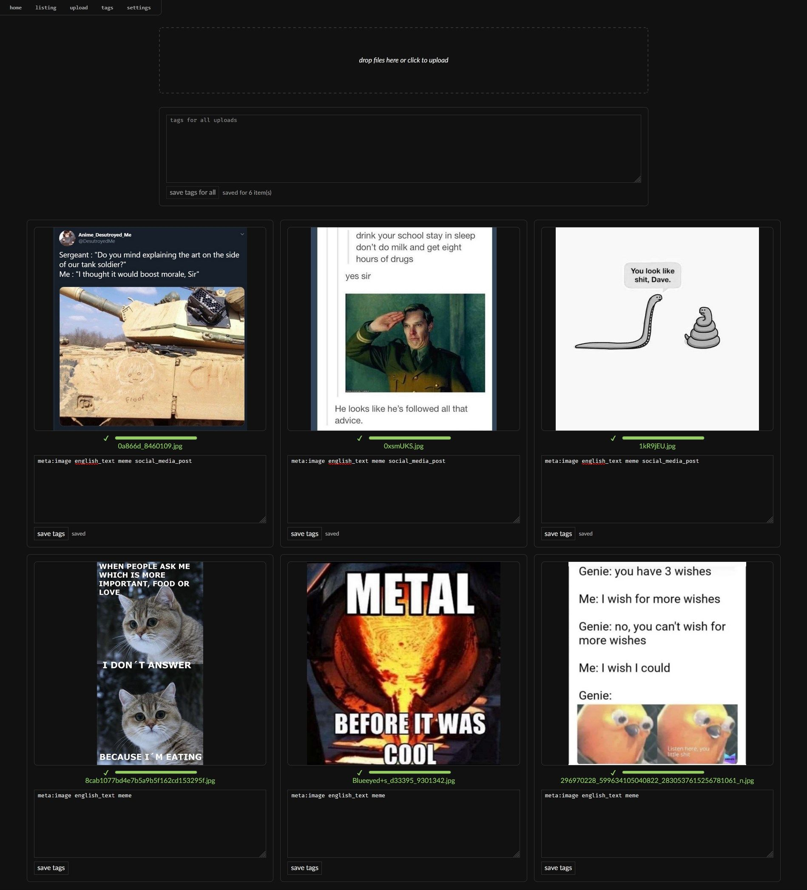
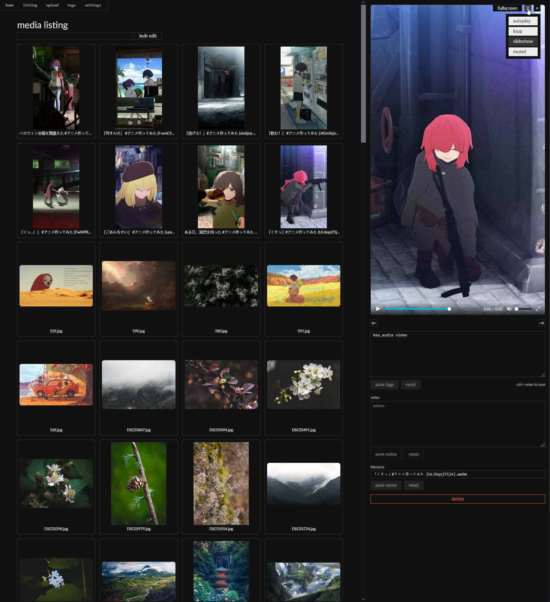
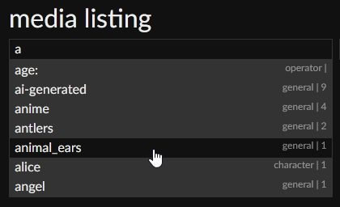
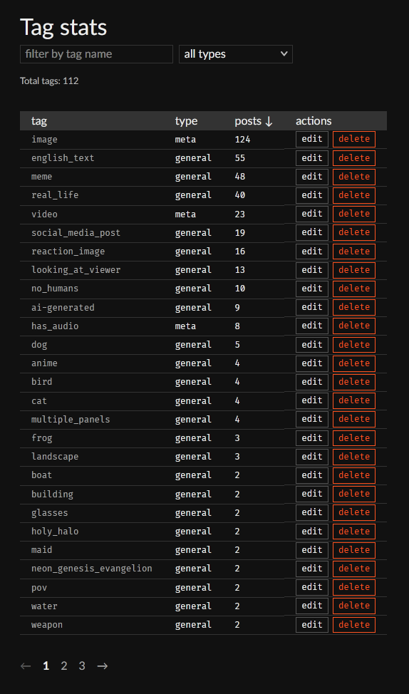
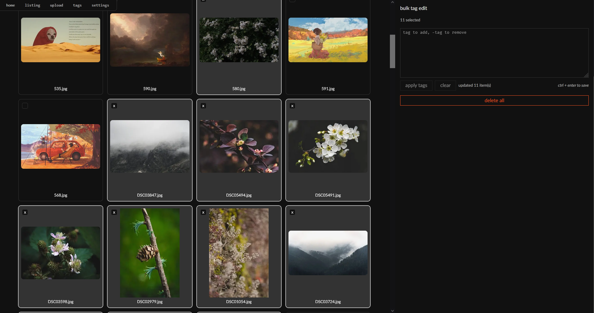
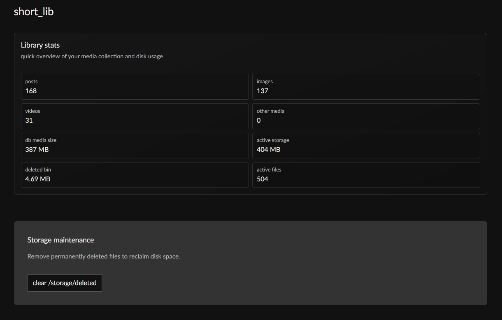

# short_lib

A personal, local, media library built around a web UI using Next.js, React, and SQLite. Supports tagging and search extended with metadata like resolution, duration, age, aspect ratio, etc - [full reference](docs/SEARCH_SYNTAX.md)

## What can you do with it

- Upload images and videos, it automatically generates thumbnails and adds basic tags.
- Search with tag logic (`AND`/`OR`/negation) plus operator filters.
- Edit tags, notes, and filenames. Tags can be edited in bulk.
- Read a file's own metadata in the panel: codec, bitrate, frame rate, bit depth, EXIF,
  and the generation parameters embedded in AI-made PNGs.
- Give tags aliases, descriptions, and implications (tagging `cat` can auto-add `animal`).
- Find similar posts (`similar:<id>`): re-encodes, resized copies, and a clip next to the
  video it was cut from.
- Download a multi-selection as a zip.
- Soft-delete media into a deleted bin and clear it from the UI.
- Preview and play/slideshow the filtered list of media in fullscreen.

## Screenshots

### Upload



### Listing



### Search and tag suggestions



### Tag list



### Bulk edit



### Global stats



## Limitations

- Limited Matroska video support.
- No support for video features like multiple tracks, subtitles, etc.
- No user accounts.

## Prerequisites

- Node.js + npm
- `ffmpeg` and `ffprobe` available on `PATH` for full video support
  - video metadata extraction on upload, and the file info panel for video and audio
    (`ffprobe`)
  - video preview frame extraction, hover preview clips, and re-encoding downloads
    (`ffmpeg`)
  - MKV streaming remux to MP4 (`ffmpeg`)
- `exiftool` on `PATH` for the file info panel on images (EXIF, ICC, PNG text chunks).
  Without it that section says so; nothing else is affected.

Each of these can be named explicitly in `.env` instead of being found on `PATH`, via
`FFMPEG_PATH`, `FFPROBE_PATH` and `EXIFTOOL_PATH`. That matters when the app runs as a
service: a Windows service running as LocalSystem sees the machine `PATH` only, so a tool
installed into a user `PATH` directory is invisible to it.

## Quick start

1. Install dependencies:

```bash
npm install
```

2. Create your local `.env` from the example and adjust values as needed:

Example `.env`:

```env
STORAGE_DIR=H:/short_lib/storage/
THUMB_PIXELS=100000

# Only needed when a tool is not on the PATH the app runs with:
EXIFTOOL_PATH=C:/bin/exiftool.exe
```
- `STORAGE_DIR` (required): base directory for media and derivatives.
- `THUMB_PIXELS` (required): target total pixels for thumbnails and hover previews.
- `FFMPEG_PATH`, `FFPROBE_PATH`, `EXIFTOOL_PATH`: optional, absolute paths to the external
  tools. Default to the bare command name, found on `PATH`.

3. Start development server:

```bash
npm run dev
```

4. Open `http://localhost:3000`.

5. Media uploaded before `similar:` existed needs hashing once (resumable, ~17 minutes for
   this library):

```bash
npm run backfill:similar
```

## Implementation details

### Storage layout

`STORAGE_DIR` uses these folders:

- `full/YYYY/MM/<checksum>.<ext>` - original uploaded media
- `thumbs/YYYY/MM/<checksum>.jpg` - thumbnail derivative
- `vprevs/YYYY/MM/<checksum>.mp4` - short silent AV1 clip, played on hover for videos
- `tmp/` - temporary upload/transcode files
- `deleted/` - soft-deleted files (same sub-structure as above), cleared from the UI
- `backups/` - automatic database copies

### Backup and migration

To move or back up the full library, keep the entire `STORAGE_DIR` folder (all media + derivatives + `shortlib.db`).

The database also backs itself up to `backups/shortlib-YYYY-MM-DD.db` every three days,
keeping ten. Those copies are always consistent, so point an external backup tool at them
rather than the live database. To restore, stop the app and copy one over `shortlib.db`.

On another machine, copy `STORAGE_DIR` and update `STORAGE_DIR` in `.env`.

### Architecture notes

[docs/ARCHITECTURE.md](docs/ARCHITECTURE.md)
